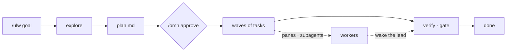

# oh-my-herdr

Let Claude Code act as the **lead** and split a big job across several agents and models: workers
in [herdr](https://herdr.dev) panes and Claude Code subagents, each picked per task by category and
remaining quota. Inspired by [OmO (oh-my-openagent)](https://omo.dev).

In one line: **type `/ulw <goal>`, and the lead plans, dispatches, waits and verifies; you approve
the plan and watch the progress bar.**



## Quick start

**1. Install.** You need [herdr](https://herdr.dev), python3, and a logged-in Claude Code. In Claude Code:

```text
/plugin install oh-my-herdr --marketplace andyjjrt/oh-my-herdr
```

Answer `y` to `Add marketplace?`, then pick an install scope.

**2. Open Claude Code inside herdr.** Start `herdr`, then run `claude` in a pane, in your project.
Or use [herdr-core](https://github.com/herdrdev/herdr-core) and the Herdr desktop app: run `claude`
in a Herdr app pane, and workers start as hc terminals there
([Where workers run](docs/configuration.md#where-workers-run-herdr-or-herdr-core)).

**3. Check the setup once.** It shows the config in effect, the agents it needs and each
subscription's quota; fix anything it flags.

```text
/omh check
```

**4. Go.**

```text
/ulw paginate the orders API and add tests
```

The lead explores and drafts a plan, then stops for you: read `.omh/runs/<run>/draft.md` (`/omh plan` shows it
beside the lead) and approve it with `/omh approve`. From there it dispatches wave after wave, and
is woken whenever a wave finishes or a worker gets stuck.

> Add `.omh/` to your project's `.gitignore`; each run's plan and results live there.

**Optional: cheaper models as workers.** Workers are Claude Code by default. To hand grunt work to
OpenCode Go models, install [senpi](https://github.com/code-yeongyu/senpi) and log in:

```sh
bun add -g @code-yeongyu/senpi   # or: npm install -g --ignore-scripts @code-yeongyu/senpi
senpi                            # then /login → OpenCode Go
```

## Commands

| Command | What it does |
| --- | --- |
| `/ulw <goal>` | Start a run: explore → plan → approve → waves → verify → gate |
| `/omh check` | The config in effect, the agents it needs, quota per profile |
| `/omh status` | The current run, short; `/omh status full` lists every task and worker |
| `/omh plan` | Preview the current run's plan beside the lead; again to close |
| `/omh approve` | Approve the draft (it becomes the run's plan.md) so the lead can split it into waves |
| `/omh board` | Toggle the board pane: every wave, task, worker and quota |
| `/omh quota` | Each subscription's usage now |
| `/omh teardown` | Close every worker |

You can also just ask: "ulw", "split this across several agents" or "use herdr to parallelize this"
loads the same workflow.

## What it adds on top of herdr

- **Plan first, waves second.** The lead writes the plan in prose and stops until you approve it;
  only then does it split it into waves of tasks that own disjoint files, with a gate after each.
- **Panes and subagents, side by side.** A task goes to a herdr pane (any agent, any provider) or to
  a Claude Code subagent of the lead (no pane, no startup wait), as its category's profiles say.
  Both are watched, diagnosed and reported alike.
- **Explore before planning.** Read-only *scouts* fan out while the lead plans; it is woken when
  they are all back.
- **Model per task, quota first.** Every dispatch states an intent, a category and why; routing
  takes the first profile whose provider has quota left, and reviews avoid the implementer's
  model family. Any provider can report its quota with a one-line command.
- **The lead never idles in a turn.** It ends its turn after dispatching; the mod wakes it when a
  wave settles or a worker needs it, with a diagnosis (`quota-exhausted`, `permission-prompt`,
  `config-error`, `crashed`, `interrupted`).
- **Visible progress.** A bar in the hint line under the prompt (or a row above it, or your own
  status line), and the full board in a pane.
- **A quality log.** Each verified task's one-line quality note, profile and duration go to
  `~/.local/state/oh-my-herdr/history.jsonl`, for judging which profile suits which work.

## Docs

| Doc | For |
| --- | --- |
| [Configuration](docs/configuration.md) | Profiles, categories, pane vs subagent workers, worker tabs, agents, mod options |
| [Quota](docs/quota.md) | How quota is read and used, and adding a provider of your own |
| [Status line](docs/status-line.md) | Where progress shows, and adding it to your own status line |
| [Architecture](docs/architecture.md) | The pieces, one run, the worker state machine, guards, `.omh/` |
| [Setup reference](skills/oh-my-herdr/references/setup.md) | herdr and senpi setup in detail (also what the lead reads) |
| [Changelog](CHANGELOG.md) | What changed in each version |
| [The lead's workflow](skills/oh-my-herdr/SKILL.md) | The skill the lead follows; brief templates in [roles.md](skills/oh-my-herdr/references/roles.md) |

The bundled `herdr` skill is herdr's own guide to panes, tabs, workspaces and agents, copied
unmodified from [herdrdev/herdr](https://github.com/herdrdev/herdr/tree/master/skills/herdr)
(Apache-2.0; see [NOTICE.md](skills/herdr/NOTICE.md)). If you installed it separately, remove that
copy so it doesn't load twice.

## Troubleshooting

| Symptom | Cause and fix |
| --- | --- |
| The lead has no `omh_dispatch` tool | The mod only starts in a lead inside a herdr pane (`HERDR_ENV=1`): start `herdr`, run `claude` in a pane |
| A Claude worker waits at "Is this a project you created or one you trust?" | That folder isn't trusted yet: accept it once in that pane |
| `config-error` | A wrong model id, a missing login or API key; re-dispatching fails the same way. Fix the config, confirm with `/omh check` |
| `quota-exhausted` or `no-profile` | A subscription ran out; the lead re-dispatches elsewhere. If all are out, `/omh quota` shows when each resets |
| A subagent worker is `blocked` | It waits on a permission prompt in the lead's session |
| Two workers edited the same file | The plan's `owns` was wrong: `/omh teardown`, and ask the lead to re-plan |

## Development

```sh
claude --plugin-dir ~/codes/github/oh-my-herdr   # or add the path to CLAUDE_CODE_PLUGIN_DIRS
claude plugin validate .
claude plugin test .
```

## License

MIT; see [LICENSE](LICENSE). `skills/herdr/` comes from the herdr project and is Apache-2.0; see
[skills/herdr/LICENSE](skills/herdr/LICENSE).
