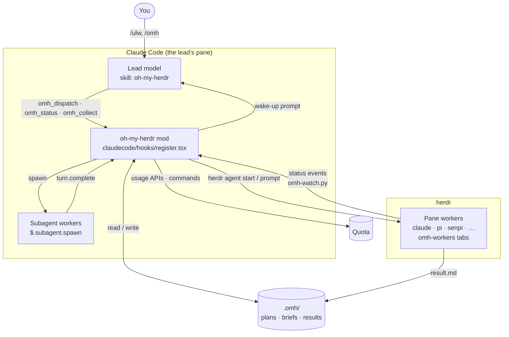
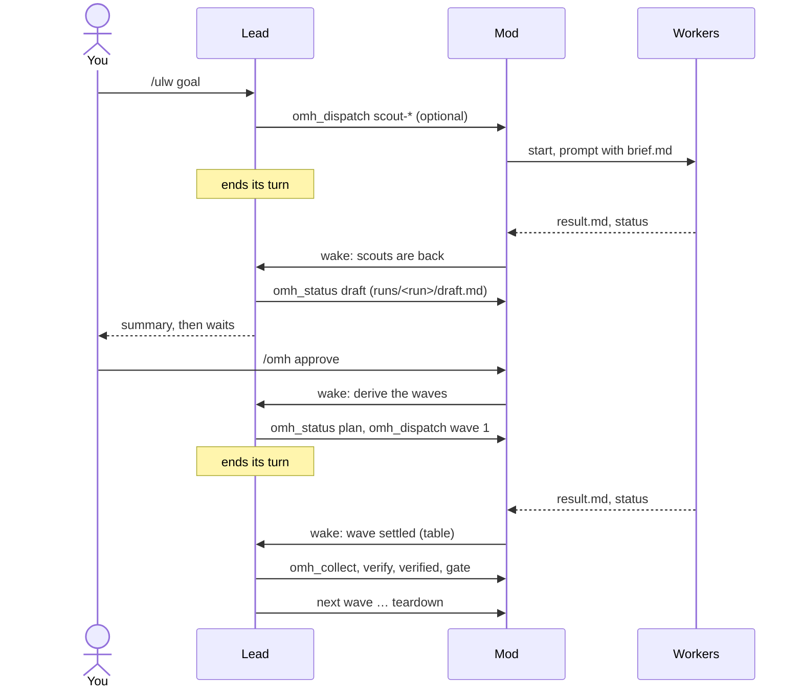
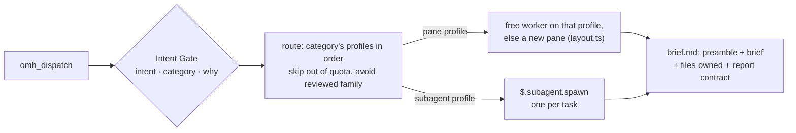
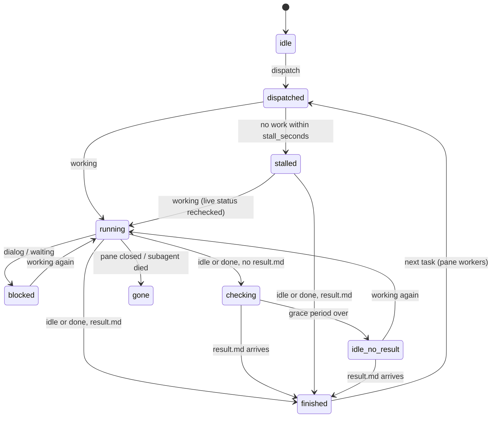

# Architecture

oh-my-herdr is a Claude Code **mod** (`claudecode/`) plus a **skill** (`skills/oh-my-herdr/`). The skill
teaches the lead the workflow; the mod does the bookkeeping: it gives the lead its `omh_*` tools,
starts and watches workers, and wakes the lead when there is something to do. The files under
`.omh/` are the source of truth; the mod's in-memory state is rebuilt from them after a reload.

## The pieces



| Module | Does |
| --- | --- |
| `claudecode/hooks/register.tsx` | Claude Code wiring: tools, commands, render sites, guards. Dormant outside herdr and in worker panes (`OMH_ROLE=worker`) |
| `core/actions.ts` | What each tool and command does: dispatch, spawn, collect, status, check, teardown |
| `core/runtime.ts` | The live side: watchers, timers, alerts, wake-ups, quota refresh, reconcile after a reload |
| `core/settle.ts` | The worker state machine (pure) |
| `core/route.ts` · `core/quota.ts` | Category → profile, skipping providers out of quota ([quota.md](quota.md)) |
| `core/subagent.ts` | Subagent workers: status mapping, the report contract |
| `core/backend.ts` | Pane workers in herdr or herdr-core: picks where new ones start, routes each call by its pane id |
| `core/herdr.ts` · `core/hc.ts` | The herdr and `hc` CLIs; `hc:<address>` is an hc worker's pane id |
| `core/layout.ts` | Where the next herdr pane worker goes: tabs and splits |
| `core/diagnose.ts` | Why a worker stopped, from its screen (or a subagent's answer) |
| `core/plan.ts` · `core/files.ts` | The plan, task status, and the `.omh/` layout |
| `core/text.ts` · `core/md.ts` | What the lead and you read: wake-ups, status, tables |

## One run



The lead never waits inside a turn. After dispatching it ends its turn; the mod gathers what
happens and wakes it with one prompt when a wave settles, the scouts are all back, or a worker needs
it. Wake-ups queue in `$.state`, so a mod reload loses none.

## Several runs, and the bound run

Drafts do not queue behind each other: each `omh_status draft` with a new `name` is its own run
under `.omh/runs/`, and `/omh runs` lists them all (draft · approved · running · finished · closed)
with each run's lead and root. `/omh approve [<id>]` approves one by id or suffix.

oh-my-herdr does not create, remove or track git worktrees. The one rule: **`/omh approve [<id>]`
binds this session to that run, in whatever checkout the session runs in.** To work a run in its
own checkout, make the worktree yourself:

```sh
git worktree add ../repo.worktrees/x -b feat/x
cd ../repo.worktrees/x && claude
/omh approve <id>
```

A session follows **one** run at a time. Without a binding it follows `.omh/current-run`
(`draft` with a `name` sets it; `/omh approve` with no id approves it and binds). With one
(`$.state.bound`, `{ run, root }`, kept across a reload) its own run wins over `current-run`, and
`paths().root` is the session's own git toplevel. A binding comes from `/omh approve` (`bindRun`) or
from `OMH_RUN` at boot (only if the session was never bound and the run has no `closed.json`).

- A bound session re-approves its own run with no id (or its id). `/omh approve <other>` is refused
  until its run is finished or closed; then it rebinds.
- `draft` with a new `name` from a bound session writes the draft and keeps the binding and
  `current-run`; the reply says how to approve it.
- Two leads in one checkout are allowed. That is the user's responsibility; nothing guards it.
- **A run with a live lead is not shared.** An unbound session treats `current-run` as none when that
  run's `lead.json` names another live pane (it does not follow it, and its status, plan and
  dispatch ignore it). `/omh approve <run>` on such a run is refused; `/omh approve <run> force` is
  the explicit takeover: `lead.json` is rewritten, and the old lead drops its binding at its next
  refresh with a wake-up ("taken over by …").
- **Close from another session.** When a bound run is closed elsewhere (`/omh close <run> force`),
  the bound session unbinds at its next refresh or poll and is woken once. Closing removes the run's
  `status.json`, and closed runs are left out of `.omh/status.json`'s `runs`.
- **The dispatch prompt** spells out the handoff, so a worker needs nothing from the brief to hand
  its result back: `Your task is in <brief.md>: read it and do it. You own: <files>. When you are
  finished, or cannot continue, write your report to <result.md> (…), then reply with exactly one
  line: DONE <result.md> or BLOCKED <one-sentence reason>.` (one line for a pane). A scout is told it
  is read-only; a subagent is told its final reply is the report, which the mod saves. `brief.md`
  repeats this in "How to report back". A lead's own `hc send` to a worker should follow the same shape.
- On bind, `runs/<run>/lead.json` is `{ pane, root }` (`pane` is `leadId()`). `finish` and `close`
  are state only: they write `finished.json` / `closed.json`, never touch git. `close` tears down
  the run's workers and unbinds a session bound to it; without `force` it refuses a run whose
  lead pane is live and not this session's, and an unfinished run.

`.omh/` is **central**: it resolves to the main checkout's through `git rev-parse --git-common-dir`,
so a lead in a worktree and a lead in the main checkout share it. `OMH_DIR` overrides it.

## Several leads, one .omh

Every lead of a project reads and writes the same `.omh/`, including `agents/`. What is *this*
session's is decided by one predicate, `ownsWorker(w, p, sessionRun, lead)` in `core/files.ts`.

Every worker file written by `spawn`, `startSubagent` and `dispatch` records `lead`: the session's
identity from `leadId()` in `runtime.ts` (its herdr pane, else `hc:<terminal>`). A file with `lead`
is owned exactly when `lead` equals this session's, whatever its `cwd` or `run`. A lead restarted in
a new pane has a new identity and treats its old workers as foreign (`omh_teardown` with a name
still reaches them).

`omh_spawn` records the bound run in the agent file, and dispatch records the task's. When a task
closes (verified, abandoned, collected) `freeWorker` in `actions.ts` resets the worker in `$.state`
and rewrites its agent file (`run`, `task`, `task_dir`), so the file never keeps a stale run.
`omh_spawn` refuses a name whose file belongs to another lead while its pane is live, and
`freeName` skips names that have an agent file. Reconcile on a reload, `omh_teardown` with no names
and worker reuse in dispatch touch only owned workers; a name list still reaches any worker. Dispatch
reuses only workers whose `cwd` is this session's root (`ownedNames({ usableHere: true })`). Stale
files whose pane is gone are not counted against `max_concurrent`.

A bound lead's scouts live in `runs/_scout/<tag>-<id>` (`<tag>` is the run's `r`+4 characters, as in
worker names) and `omh_collect`, `abandon` and `recheck` take either the plain or the tagged id. The
event `session` in `events.jsonl` is `leadId()`.

Known limits: without a lead identity (outside herdr/hc) no `lead` is recorded and `current-run` is
shared; two unbound sessions still share `current-run` for drafts; two leads in one
checkout share its files; a bound session's top-level status write can be stale.

## Approvals drop file

An approvals drop file (`.omh/approvals/<run>` holding the draft digest) approves a run from
outside; it is the contract for a future inbox/Discord plugin. Each session's poller applies:

- a session **bound** to that run, or the unbound session whose open run it is (the one drafting
  it), claims it (renames it to `<run>.claimed-<session>`), approves with `approveRun` (which binds)
  and wakes itself;
- a run **nobody is bound to** is approved without binding by any session's poller: `plan.md` is
  written and the event logged. Whoever later runs `/omh approve <id>` binds to it. The plugin may
  then start its own worktree and lead (`git worktree add`, then `claude`) and send `/omh approve <id>`;
- a run another live lead is bound to is left alone;
- a bad digest, or a file for a closed run, is renamed to `<run>.rejected`.

## Dispatch



Pane workers are reused for later tasks on the same profile; a subagent runs one task. New panes
open in `omh-workers` tabs in the lead's workspace, at most `max_panes_per_tab` each
([configuration.md](configuration.md#worker-tabs)).

## A worker's life

The same state machine (`core/settle.ts`) follows pane workers and subagent workers; only
where the status comes from differs.



| | Pane worker | Subagent worker |
| --- | --- | --- |
| Status from | herdr's event stream, or `hc events` for an hc worker (`scripts/omh-watch.py`) | `$.subagent.list()` every 10 s |
| End | idle or done on screen | its `turn.complete` |
| Report | writes `result.md`, replies `DONE <path>` | its final reply, saved as `result.md` by the mod |
| Diagnosis reads | the pane's screen | its status, end reason and answer |

`blocked`, `stalled`, `idle_no_result` and `gone` wake the lead at once with a diagnosis
(`quota-exhausted`, `permission-prompt`, `config-error`, `crashed`, `interrupted`, `no-status-report`,
`unknown`). `no-status-report` is a startup timeout on hc where the agent never reported a status
(an agent too old for OSC 7501); its hint points at `/omh check`.
The watcher reports changes only, so before calling a worker stalled the mod asks the pane for its
live status; `omh_status` action `recheck` does the same on demand, for the worker the task's
`dispatch.json` names now (not an older worker that once held it).

A wake-up waits 1.5 s so several events become one prompt. At send time each section is checked
again: an alert whose worker was torn down, re-dispatched or has moved on is dropped, and a wave
table is rebuilt from the live state (or dropped if a task is working again).

## Guards

- **File ownership.** While a task runs, the files it `owns` are refused to every other writer
  (Edit, Write, NotebookEdit): the lead, and other subagents. The subagent that owns them may write.
- **Plan approval.** `omh_status plan` is refused until you approve the run's draft with
  `/omh approve`, which renames it to `plan.md`; a changed plan.md needs approving again. Each piece
  of work gets its own run directory when it is first drafted (`omh_status draft` with a `name`), so
  a new plan can never be saved into an old run.
- **Session root.** Ownership is relative to `paths().root`, which is the session's own git toplevel (the checkout it runs in).
- **Gates.** A wave cannot be dispatched until every earlier wave's gate is marked passed.

## `.omh/`

```text
.omh/
├── config.json                  optional, per project
├── current-run                  id of the run an unbound session follows (set at its first draft)
├── status.json                  summary for a custom status line: the current run's fields + `runs`
├── tab.json                     the omh-workers tabs of an unbound session
├── events.jsonl                 append-only lifecycle events, one JSON object a line
├── approvals/<run>              drop file: the draft digest approves that run
├── agents/<worker>.json         one worker: pane or agent:<id>, profile, task
└── runs/
    ├── <date>-<name>/
    │   ├── tab.json · status.json   the run's own worker tabs and progress (bound session; status removed when finished)
    │   ├── lead.json                { pane, root } of the session bound to the run
    │   ├── finished.json · closed.json
    │   ├── draft.md                 the plan being drafted, until /omh approve
    │   ├── plan.md · plan.approved  the approved plan, and its digest
    │   ├── plan.v<n>.md             earlier approved plans, after a replan
    │   ├── plan.json · gates.json
    │   └── <task>/brief.md · result.md · dispatch.json · verified.json | abandoned.json
    └── _scout/<scout>/          scouts: same files, plus collected.json
```

`events.jsonl` lines are `{ at, run, event, session, … }`; events: `draft`, `approved`, `bound`,
`unbound`, `wave_settled`, `alert`, `finished`, `closed`, `approval_rejected`.

Each verified or abandoned task also adds a line (intent, profile, duration, outcome, the lead's
quality note) to `~/.local/state/oh-my-herdr/history.jsonl`.
