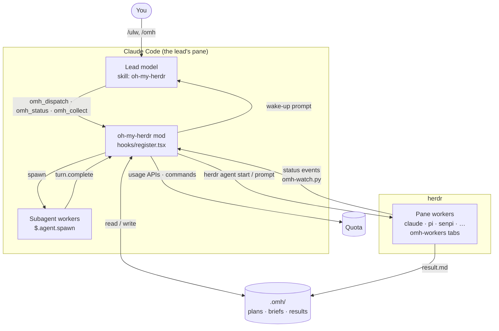
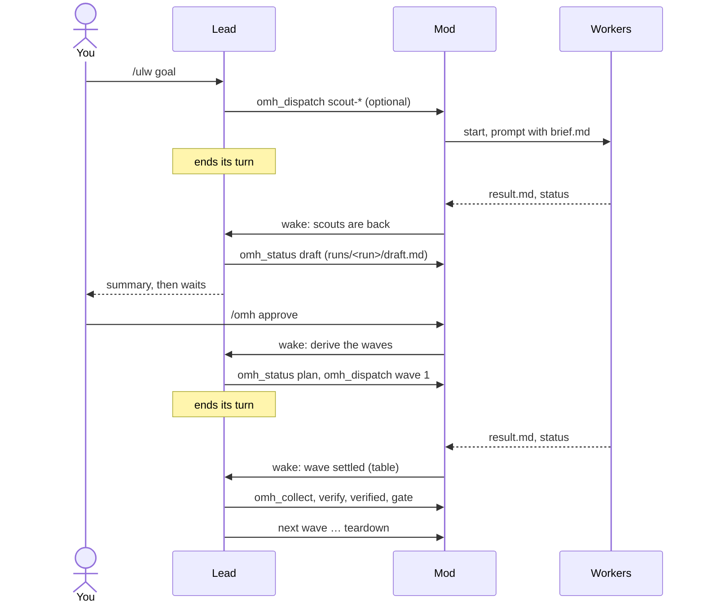
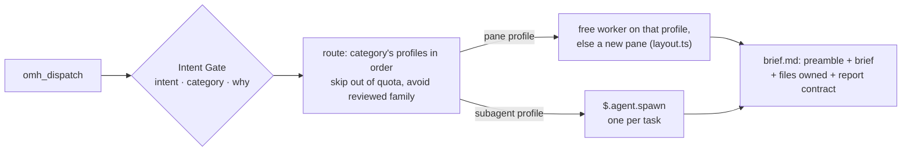
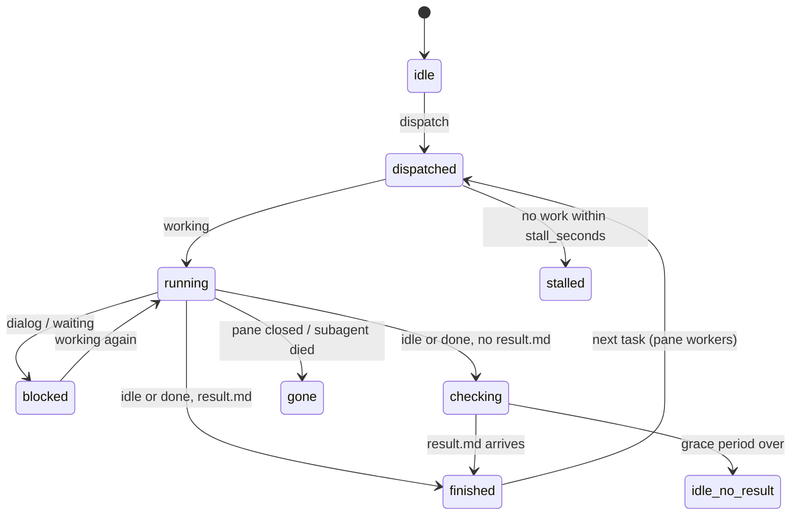

# Architecture

oh-my-herdr is a Claude Code **mod** (`hooks/`) plus a **skill** (`skills/oh-my-herdr/`). The skill
teaches the lead the workflow; the mod does the bookkeeping: it gives the lead its `omh_*` tools,
starts and watches workers, and wakes the lead when there is something to do. The files under
`.omh/` are the source of truth; the mod's in-memory state is rebuilt from them after a reload.

## The pieces



| Module | Does |
| --- | --- |
| `hooks/register.tsx` | Wiring only: tools, commands, render sites, guards. Dormant outside herdr and in worker panes (`OMH_ROLE=worker`) |
| `hooks/lib/actions.ts` | What each tool and command does: dispatch, spawn, collect, status, check, teardown |
| `hooks/lib/runtime.ts` | The live side: watchers, timers, alerts, wake-ups, quota refresh, reconcile after a reload |
| `hooks/lib/settle.ts` | The worker state machine (pure) |
| `hooks/lib/route.ts` · `quota.ts` | Category → profile, skipping providers out of quota ([quota.md](quota.md)) |
| `hooks/lib/subagent.ts` | Subagent workers: status mapping, the report contract |
| `hooks/lib/layout.ts` | Where the next pane worker goes: tabs and splits |
| `hooks/lib/diagnose.ts` | Why a worker stopped, from its screen (or a subagent's answer) |
| `hooks/lib/plan.ts` · `files.ts` | The plan, task status, and the `.omh/` layout |
| `hooks/lib/text.ts` · `md.ts` | What the lead and you read: wake-ups, status, tables |

## One run



The lead never waits inside a turn. After dispatching it ends its turn; the mod gathers what
happens and wakes it with one prompt when a wave settles, the scouts are all back, or a worker needs
it. Wake-ups queue in `$.state`, so a mod reload loses none.

## Dispatch



Pane workers are reused for later tasks on the same profile; a subagent runs one task. New panes
open in `omh-workers` tabs in the lead's workspace, at most `max_panes_per_tab` each
([configuration.md](configuration.md#worker-tabs)).

## A worker's life

The same state machine (`hooks/lib/settle.ts`) follows pane workers and subagent workers; only
where the status comes from differs.



| | Pane worker | Subagent worker |
| --- | --- | --- |
| Status from | herdr's event stream (`scripts/omh-watch.py`) | `$.agent.list()` every 10 s |
| End | idle or done on screen | its `turn.complete` |
| Report | writes `result.md`, replies `DONE <path>` | its final reply, saved as `result.md` by the mod |
| Diagnosis reads | the pane's screen | its status, end reason and answer |

`blocked`, `stalled`, `idle_no_result` and `gone` wake the lead at once with a diagnosis
(`quota-exhausted`, `permission-prompt`, `config-error`, `crashed`, `interrupted`, `unknown`).

## Guards

- **File ownership.** While a task runs, the files it `owns` are refused to every other writer
  (Edit, Write, NotebookEdit): the lead, and other subagents. The subagent that owns them may write.
- **Plan approval.** `omh_status plan` is refused until you approve the run's draft with
  `/omh approve`, which renames it to `plan.md`; a changed plan.md needs approving again. Each piece
  of work gets its own run directory when it is first drafted (`omh_status draft` with a `name`), so
  a new plan can never be saved into an old run.
- **Gates.** A wave cannot be dispatched until every earlier wave's gate is marked passed.

## `.omh/`

```text
.omh/
├── config.json                  optional, per project
├── current-run                  id of the run the mod follows (set at its first draft)
├── status.json                  progress for a custom status line
├── tab.json                     the omh-workers tabs
├── agents/<worker>.json         one worker: pane or agent:<id>, profile, task
└── runs/
    ├── <date>-<name>/
    │   ├── draft.md                 the plan being drafted, until /omh approve
    │   ├── plan.md · plan.approved  the approved plan, and its digest
    │   ├── plan.v<n>.md             earlier approved plans, after a replan
    │   ├── plan.json · gates.json
    │   └── <task>/brief.md · result.md · dispatch.json · verified.json | abandoned.json
    └── _scout/<scout>/          scouts: same files, plus collected.json
```

Each verified or abandoned task also adds a line (intent, profile, duration, outcome, the lead's
quality note) to `~/.local/state/oh-my-herdr/history.jsonl`.
