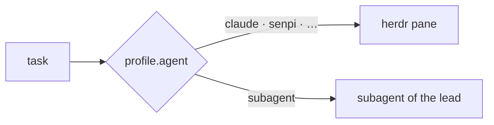

# Configuration

## Where the config comes from

The first file found wins, whole (files are not merged):

1. `$OMH_CONFIG`
2. `<project>/.omh/config.json`
3. `~/.config/oh-my-herdr/config.json`
4. The built-in [config.default.json](../skills/oh-my-herdr/assets/config.default.json)

Start from a copy of the built-in one. `/omh check` shows the file in effect and any problem in it.

## Profiles and categories

A **profile** is one agent + model. A **category** lists profiles in order; a task goes to the
first whose provider still has [quota](quota.md), preferring one outside the reviewed task's
family for a review.

```jsonc
{
  "max_concurrent": 5,        // workers at once, panes and subagents together
  "max_panes_per_tab": 4,     // see Worker tabs
  "profiles": {
    "claude-sonnet": { "agent": "claude", "family": "claude",
                       "args": ["--model", "sonnet", "--permission-mode", "acceptEdits"] },
    "go-deepseek":   { "agent": "senpi", "family": "deepseek",
                       "args": ["--provider", "opencode-go", "--model", "deepseek-v4.1-flash", "--thinking", "max"] },
    "sub-explore":   { "agent": "subagent", "family": "claude", "subagent_type": "Explore", "model": "haiku" }
  },
  "categories": {
    "explore":  ["sub-explore", "go-deepseek"],
    "deep":     ["go-deepseek", "claude-sonnet"],
    "security": { "profiles": ["claude-sonnet"], "preamble": "preambles/security.md" }
  }
}
```

| Profile field | Meaning |
| --- | --- |
| `agent` | How the worker starts: `claude`, `senpi` or `subagent` built in ([agents.json](../skills/oh-my-herdr/assets/agents.json)), or one of `agents` |
| `args` | Passed unchanged to that agent's CLI: model, reasoning level, permission flags |
| `family` | Any label; a reviewer is routed outside the reviewed task's family |
| `model`, `subagent_type` | Subagent profiles only: the model alias or id, and the agent type (`general-purpose` by default) |
| `quota` | The provider it bills, when it can't be inferred; `null` skips checks ([quota.md](quota.md)) |

The categories the lead uses are `explore`, `librarian`, `quick`, `deep`, `visual-engineering`,
`writing`, `oracle` and `reviewer`; a category may also be a single profile name, or an object with
its own `preamble` file (a role's opening instructions, from `skills/oh-my-herdr/assets/preambles/`
by default).

## Pane workers and subagent workers



| | Pane worker | Subagent worker |
| --- | --- | --- |
| Starts | in 10 to 30 s | at once |
| Models | any agent and provider | Claude models only |
| Quota and permissions | its own | the lead's |
| Look at it | switch to its pane | its transcript only |
| Reused | yes, for the next task on its profile | no, one task |
| Outlives the lead | yes | no |

Subagents suit `explore`, `quick` and read-only reviews; keep long implementation and other
providers in panes. `Explore` and `Plan` subagents are read-only, which is fine: a subagent's final
reply is saved as its `result.md`. A subagent waiting on a permission prompt asks in the lead's
session.

The built-in config mixes them:

| Category | Profiles, first usable wins (◆ subagent) |
| --- | --- |
| explore | ◆ sub-explore → go-fast → go-deepseek |
| quick | ◆ sub-haiku → go-fast → go-deepseek |
| librarian | go-fast → ◆ sub-haiku → go-deepseek |
| oracle, reviewer | claude-review → ◆ sub-review → go-deepseek |
| deep | go-deepseek → claude-sonnet → ◆ sub-sonnet |
| visual-engineering | claude-sonnet → ◆ sub-sonnet → go-deepseek |
| writing | go-deepseek → ◆ sub-sonnet → claude-sonnet |

## Worker tabs

Pane workers open in `omh-workers` tabs in the lead's own workspace; herdr adds a new tab after the
workspace's other tabs. A tab takes `max_panes_per_tab` panes (default 4): its first pane, then
splits of the last pane, right and down in turn. The next worker opens `omh-workers-2`, and so on.
A pane freed by `/omh teardown` is used again.

## Agents (launch definitions)

```jsonc
"agents": {
  "claude":   { "launch": "herdr-kind", "kind": "claude" },
  "senpi":    { "launch": "command", "command": ["senpi"], "detect_as": "pi", "stall_seconds": 45,
                "diagnose": { "config-error": ["Model is unavailable"] } },
  "subagent": { "launch": "subagent" }
}
```

| Launch | Starts the worker by |
| --- | --- |
| `herdr-kind` | `herdr agent start <name> --kind <kind> --pane <pane> -- <args>` |
| `command` | running `<command> <args>` in the pane with `HERDR_AGENT=<detect_as>`, then naming the agent herdr detects. For forks and wrappers herdr doesn't know |
| `subagent` | `$.agent.spawn` in the lead's session: no pane |

`stall_seconds` (default 30) is how long a worker may take to start working after a dispatch.
`diagnose` adds screen patterns (regular expressions) per verdict to the built-in ones.

## Mod options (in `/plugin`)

| Option | Default | Description |
| --- | --- | --- |
| `display` | `statusline` | Where the run's progress shows: `statusline`, `panel`, `off` ([status-line.md](status-line.md)) |
| `wakeOnSettle` | on | Wake the lead when a wave settles or a worker needs it |
| `notifyHuman` | on | Also send you a herdr notification |
| `autoContinue` | off | When the run isn't finished and no worker is busy, prompt the lead to keep going |
| `autoContinueMax` | 3 | Most auto-continues in a row (any prompt you type resets it) |
| `verbose` | off | Show omh_* tool calls and results in full; off shows one line each (ctrl+o expands) |

With [prismantis](https://github.com/NahumLitvin/prismantis) installed, `/omh plan` previews
plan.md in a Claude Code pane drawn in color, and an expanded worker report or result with tables
is drawn as markdown. Without it, `/omh plan` opens a herdr pane with the first of `leaf --watch`,
`glow`, `bat` or `less` installed.
