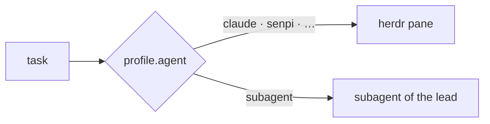

# Configuration

## Where the config comes from

The first file found wins, whole (files are not merged):

1. `$OMH_CONFIG`
2. `<project>/.omh/config.json`
3. `~/.config/oh-my-herdr/config.json`
4. The built-in [config.default.json](../skills/oh-my-herdr/assets/config.default.json)

Start from a copy of the built-in one. `/omh check` shows the file in effect and any problem in it.

## Profiles and categories

A **profile** is one agent + model. A **category** lists profiles in order; a task goes to the
first whose provider still has [quota](quota.md), preferring one outside the reviewed task's
family for a review.

```jsonc
{
  "max_concurrent": 5,        // workers at once, panes and subagents together
  "max_panes_per_tab": 4,     // see Worker tabs
  "profiles": {
    "claude-sonnet": { "agent": "claude", "family": "claude",
                       "args": ["--model", "sonnet", "--permission-mode", "auto"] },
    "go-deepseek":   { "agent": "senpi", "family": "deepseek",
                       "args": ["--provider", "opencode-go", "--model", "deepseek-v4.1-flash", "--thinking", "max"] },
    "sub-explore":   { "agent": "subagent", "family": "claude", "subagent_type": "Explore", "model": "haiku" }
  },
  "categories": {
    "explore":  ["sub-explore", "go-deepseek"],
    "deep":     ["go-deepseek", "claude-sonnet"],
    "security": { "profiles": ["claude-sonnet"], "preamble": "preambles/security.md" }
  }
}
```

| Profile field | Meaning |
| --- | --- |
| `agent` | How the worker starts: `claude`, `pi`, `senpi`, `opencode`, `subagent` or `oc-subagent` built in ([agents.json](../skills/oh-my-herdr/assets/agents.json)), or one of `agents` |
| `args` | Passed unchanged to that agent's CLI: model, reasoning level, permission flags |
| `family` | Any label; a reviewer is routed outside the reviewed task's family |
| `model`, `subagent_type` | Subagent profiles only: the model alias or id, and the agent type. `general-purpose` by default in Claude Code; `oc-subagent` takes its `kind` (`general`) and `model` from the agent definition unless the profile overrides them ([opencode.md](opencode.md#opt-in-opencode-child-sessions)) |
| `quota` | The provider it bills, when it can't be inferred; `null` skips checks ([quota.md](quota.md)) |

The categories the lead uses are `explore`, `librarian`, `quick`, `deep`, `visual-engineering`,
`writing`, `oracle` and `reviewer`; a category may also be a single profile name, or an object with
its own `preamble` file (a role's opening instructions, from `skills/oh-my-herdr/assets/preambles/`
by default).

## Pane workers and subagent workers



| | Pane worker | Subagent worker |
| --- | --- | --- |
| Starts | in 10 to 30 s | at once |
| Models | any agent and provider | the lead host's subagents: Claude models in Claude Code, the `oc-subagent` model (any opencode model) in opencode |
| Quota and permissions | its own | Claude Code: the lead's. opencode: the profile's model and provider |
| Look at it | switch to its pane | its transcript only |
| Reused | yes, for the next task on its profile | no, one task |
| Outlives the lead | yes | no |

Subagents suit `explore`, `quick` and read-only reviews; keep long implementation and other
providers in panes. `Explore` and `Plan` subagents are read-only, which is fine: a subagent's final
reply is saved as its `result.md`. In Claude Code, a subagent waiting on a permission prompt asks in
the lead's session. In opencode, subagent profiles are opt-in child sessions
([opencode.md](opencode.md#opt-in-opencode-child-sessions)).

The built-in config mixes them:

| Category | Profiles, first usable wins (◆ subagent) |
| --- | --- |
| explore | ◆ sub-explore → go-fast → go-deepseek |
| quick | ◆ sub-haiku → go-fast → go-deepseek |
| librarian | ◆ sub-haiku → go-fast → go-deepseek |
| oracle, reviewer | claude-review → ◆ sub-review → go-deepseek |
| deep | go-deepseek → claude-sonnet → ◆ sub-sonnet |
| visual-engineering | claude-sonnet → ◆ sub-sonnet → go-deepseek |
| writing | go-deepseek → ◆ sub-sonnet → claude-sonnet |

In opencode the Claude Code subagent profiles are hidden, so these categories fall through to their
pane profiles.

The built-in config also defines an `opencode` pane profile (opencode as a worker in a herdr pane,
started with `OMH_ROLE=worker`). No category routes to it; add `"opencode"` to a category when you
want opencode workers. It reports status on herdr only, so routing skips it on the hc backend.

### The lead's own subagents

The lead can also call the Agent tool itself, mostly `Explore` agents while it plans. The mod holds
those calls to the subagent profiles the categories route to:

| The categories route to | The lead's Agent call |
| --- | --- |
| no subagent profile (external agents only) | refused; the lead explores with scouts (`omh_dispatch`, `scout-<name>`) |
| some subagent profiles | allowed for their `subagent_type`s only, on a model listed for that type (another model, or none, becomes the first listed) |

With the built-in config the lead may start `Explore` on haiku, `general-purpose` on haiku or
sonnet and `Plan` on opus. `/ulw` tells the lead which ones it has.

In opencode the same rule applies to the built-in `subagent` tool, over `oc-subagent` profiles. No
category routes to one by default, so the tool is denied there until you add such a route
([opencode.md](opencode.md#opt-in-opencode-child-sessions)).

## Where workers run: herdr or herdr-core

Pane workers run either in **herdr** panes or in **herdr-core** (`hc`) terminals, the core that the
[Herdr desktop app](https://github.com/herdrdev/herdr-app) is a window on. The **Worker backend**
option (`/plugin` → oh-my-herdr → configure in Claude Code, `opencode.json` in opencode) picks, for
every project; a `backend` other than `auto` in config.json overrides it for that config:

```jsonc
{
  "backend": "auto",            // "auto" | "herdr" | "hc"
  "hc": {
    "panes": "tab",             // in the Herdr app: "tab" or "none"
    "notify": false             // let hc type notes about workers into the lead
  }
}
```

| `backend` | New workers start in |
| --- | --- |
| `auto` (default) | herdr panes when the lead is in herdr, hc terminals otherwise |
| `herdr` | herdr panes; refused when the lead is not in herdr |
| `hc` | hc terminals, wherever the lead runs |

In Claude Code, the mod wakes up when the lead runs in herdr (`HERDR_ENV=1`) or in an hc terminal
(`HC_TERMINAL_ID`: a Herdr app pane, or `hc run claude`); opencode wakes through the lead's session.
Workers already running keep the backend they started on, so changing `backend` mid-run is safe.

With hc:

- **Status comes from the agent itself** (OSC 7501), not from reading the screen. Claude Code and
  pi report it; an agent that does not report never becomes ready.
- **Workers get the lead's `PATH`** and `OMH_ROLE=worker`, because the hc core runs programs in its
  own environment. Secrets (API keys, tokens) are not passed, since hc shows a terminal's argv to
  anyone who lists it: put them where the core sees them, or restart the core from your shell
  with `hc server restart --fresh`.
- **Workers outlive the lead** (`--outlive-parent`) and are reattached when it starts again.
- **In the Herdr app**, with `hc.panes` set to `tab`, workers open in omh tabs of the lead's space,
  `max_panes_per_tab` to a tab, through the app's `herdr.space` and `herdr.tab` labels. With
  `none` they stay sub-agents of the lead: in the agents list, opened with a click. Outside the app
  they are plain hc terminals: `hc ls`, `hc attach <address>`.
- **hc's own notes are off** (`hc.notify`): the lead is a host session, and the adapter already
  wakes it.
- There are no desktop notifications.

## Worker tabs

Pane workers open in `omh-workers` tabs in the lead's own workspace; herdr adds a new tab after the
workspace's other tabs. A tab takes `max_panes_per_tab` panes (default 4): its first pane, then
splits of the last pane, right and down in turn. The next worker opens `omh-workers-2`, and so on.
A pane freed by `/omh teardown` is used again. (With hc, see
[Where workers run](#where-workers-run-herdr-or-herdr-core).)

## Worktrees

oh-my-herdr does not create or manage git worktrees. Make the
worktree yourself, start Claude in it, and approve the run there:

```sh
git worktree add ../repo.worktrees/x -b feat/x
cd ../repo.worktrees/x && claude
/omh approve <id>
```

`/omh approve [<id>]` binds that session to the run in whatever checkout it runs; the run's
`lead.json` records `{ pane, root }`, and `/omh runs` shows the lead and root. Two leads in one
checkout are allowed; that is your responsibility. `omh_status finish` and `/omh close [run] [force]`
only record state (`close` needs `force` for an unfinished run) and never touch git or the worktree.

### Environment

| Variable | Meaning |
| --- | --- |
| `OMH_DIR` | The `.omh/` directory. Default: the main checkout's, found through `git rev-parse --git-common-dir` (so a linked worktree shares it) |
| `OMH_RUN` | Binds a freshly started lead to that run (the checkout it starts in is its root). Used only when the session was never bound and `runs/<run>/closed.json` does not exist; closing or unbinding is not undone by a reload |
| `OMH_ROLE` | `worker` makes the mod dormant (set for every worker the mod starts); a new lead starts without it |

## Agents (launch definitions)

```jsonc
"agents": {
  "claude":   { "launch": "herdr-kind", "kind": "claude" },
  "senpi":    { "launch": "command", "command": ["senpi"], "detect_as": "pi", "stall_seconds": 45,
                "diagnose": { "config-error": ["Model is unavailable"] } },
  "subagent": { "launch": "subagent" }
}
```

| Launch | Starts the worker by |
| --- | --- |
| `herdr-kind` | `herdr agent start <name> --kind <kind> --pane <pane> -- <args>` |
| `command` | running `<command> <args>` in the pane with `HERDR_AGENT=<detect_as>`, then naming the agent herdr detects. For forks and wrappers herdr doesn't know |
| `subagent` | A subagent of the lead: `$.subagent.spawn` in Claude Code, a child session in opencode (*opt-in*, see [opencode.md](opencode.md#opt-in-opencode-child-sessions)) |

An agent whose launch is `"subagent"` can carry a `host`: `claudecode` (the default) or `opencode`.
A config filters the subagent profiles of the other host out of the categories, so one profile list
serves both.
`oc-subagent` is the opencode child-session agent in `skills/oh-my-herdr/assets/agents.json`.

`reports`, `min_version` and `version_cmd` say whether an agent can report its status to the backend:

```jsonc
"senpi": { "launch": "command", "command": ["senpi"], "reports": ["herdr", "hc"],
           "min_version": { "hc": "2026.11.21" }, "version_cmd": ["senpi", "--version"] }
```

`reports` lists the backends it reports on (absent: assumed able); `min_version` is the oldest
version that reports on a backend; `version_cmd` prints the version. Routing skips the profiles of
an agent that cannot report on the backend in use and falls through to the next in the category;
`/omh check` lists the mismatches.

`stall_seconds` (default 30) is how long a worker may take to start working after a dispatch.
`diagnose` adds screen patterns (regular expressions) per verdict to the built-in ones.

## Options

In Claude Code these are in `/plugin` → oh-my-herdr → configure; in opencode, in the plugin's
`options` object in `opencode.json` ([opencode.md](opencode.md#options)).

| Option | Default | Description |
| --- | --- | --- |
| `display` | `statusline` | Where the run's progress shows: `statusline`, `panel`, `off` ([status-line.md](status-line.md)) |
| `backend` | `auto` | Where new pane workers start: `auto`, `herdr`, `hc` ([Where workers run](#where-workers-run-herdr-or-herdr-core)) |
| `wakeOnSettle` | on | Wake the lead when a wave settles or a worker needs it |
| `notifyHuman` | on | Also send you a herdr notification |
| `autoContinue` | off | When the run isn't finished and no worker is busy, prompt the lead to keep going |
| `autoContinueMax` | 3 | Most auto-continues in a row (any prompt you type resets it) |
| `verbose` | off | Show omh_* tool calls and results in full; off shows one line each (ctrl+o expands). Claude Code only: opencode draws its own tool rows |

With [prismantis](https://github.com/NahumLitvin/prismantis) installed, `/omh plan` previews
plan.md in a Claude Code pane drawn in color, and an expanded worker report or result with tables
is drawn as markdown. Without it, `/omh plan` opens the same Claude Code pane and shows plan.md as
plain text.
