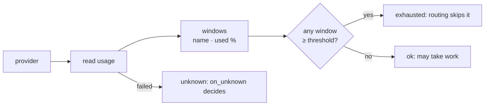

# Quota

Before every dispatch, oh-my-herdr checks how much of each subscription is used and routes around
a provider that is nearly out. A category lists profiles in order; the first one whose provider
still has quota gets the task.



## Settings

```jsonc
"quota": {
  "enabled": true,
  "threshold": 95,          // a usage window at or above this % counts as exhausted
  "cache_seconds": 120,     // how long a reading is reused
  "on_unknown": "allow",    // or "block": a failed reading counts as exhausted
  "providers": {
    "opencode-go": { "enabled": false },                       // turn one provider's check off
    "openrouter": "~/.config/oh-my-herdr/quota/openrouter.sh"  // a provider of your own (below)
  }
}
```

`/omh quota` shows the current reading of every provider; `/omh check` shows which provider each
profile bills. Both read afresh, skipping the cache.

## Built-in providers

| Provider | Usage from | Credentials | Billed by |
| --- | --- | --- | --- |
| `claude` | Anthropic's usage endpoint: 5-hour, 7-day and per-model windows | the Claude Code login (`~/.claude/.credentials.json`), or `CLAUDE_CODE_OAUTH_TOKEN` | agent `claude`, every subagent profile, `--provider anthropic` |
| `opencode-go` | OpenCode Go's usage endpoint: rolling, weekly, monthly | `OPENCODE_GO_API_KEY` / `OPENCODE_API_KEY`, or senpi's / pi's / OpenCode's `auth.json` | `--provider opencode-go` in a profile's args |

Per-model windows (Claude's `7d-opus`, say) only count against profiles that run that model.

## A provider of your own

Any other provider is a **shell command** that prints the percent used. Give it a name under
`quota.providers`, and name that provider on the profiles it bills:

```jsonc
"quota": { "providers": { "openrouter": "~/.config/oh-my-herdr/quota/openrouter.sh" } },
"profiles": {
  "or-qwen": { "agent": "senpi", "family": "qwen", "quota": "openrouter",
               "args": ["--provider", "openrouter", "--model", "qwen3-coder"] }
}
```

The command prints either one number, or one number per window:

```text
42
```

```json
{ "daily": 42, "weekly": 9 }
```

An example: credits used on OpenRouter. Check the endpoint's fields against the provider's docs;
the script, not the config, holds the key.

```sh
#!/bin/sh
# ~/.config/oh-my-herdr/quota/openrouter.sh
curl -fsS -H "Authorization: Bearer $OPENROUTER_API_KEY" https://openrouter.ai/api/v1/credits |
  jq '.data | {credits: (100 * .total_usage / .total_credits)}'
```

### Rules

| When | Then |
| --- | --- |
| a window is at `threshold` or above (100 = all used) | exhausted: routing skips the provider's profiles |
| the command exits non-zero, takes over 15 s, or prints something that is not usage | unknown, with the first stderr line as the reason; `on_unknown` decides |
| a profile's `quota` names a provider with no command | `/omh check` lists it as a problem |
| `"quota": null` on a profile | that profile is never checked |

The command runs with `sh -c`, so `~` and environment variables work. It is cached like the
built-in providers (`cache_seconds`) and runs again on `/omh quota` and `/omh check`.

## Without a usage reading

A provider nobody reads (no command, or `"quota": null`) is still guarded after the fact: when a
worker's screen shows a rate limit (`usage limit`, `429`, …), its diagnosis is `quota-exhausted`
and the lead re-dispatches the task without naming a worker, so routing picks another profile.
