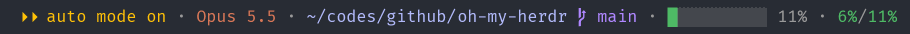

# Status line

While a run is open, the mod shows its progress (`omh ██░░░░ 2/5`, `⚠1` while a task needs you)
where the `display` option (in `/plugin`) says:

- **`statusline`** (default): at the end of Claude Code's own hint line under the prompt, e.g.
  `⏵⏵ auto mode on · esc to interrupt · omh ██░░░░ 2/5`. Claude Code keeps drawing the rest.
- **`panel`**: one row above the prompt, with the wave: `omh ██░░░░ 2/5 · W2/3 · ⚠1`.
- **`off`**: neither.

`/omh board` opens the whole board in a pane: every wave, task, worker and quota.

## Your own status line

Whatever `display` says, the mod writes the run's progress to `.omh/status.json` for a
[custom status line](https://code.claude.com/docs/en/statusline) to show. To add it to yours, paste
this to Claude Code (then you may set `display` to `off`):

> Add the oh-my-herdr run progress to my status line. Find where the oh-my-herdr plugin is
> installed and call its `statusline/omh-wave` with the status line input's
> `workspace.project_dir` as the argument; it prints a short progress line, or nothing when no run
> is open. Append that output to my current status line after the folder and branch, separated by
> ` · `. If I have no status line yet, make one: model with context %, folder, git branch, and that
> progress. Set `"refreshInterval": 5` on `statusLine` in `~/.claude/settings.json`.

`refreshInterval` matters: Claude Code otherwise reruns the status line only after each reply, so
workers finishing while the lead is idle wouldn't show.

## With several runs

`.omh/status.json` is a summary: the top-level fields are the unbound session's run, and `runs`
lists every active run. A bound lead writes its own `.omh/runs/<run>/status.json` instead.
`statusline/omh-wave` picks its run by `runs/*/lead.json`: the newest not-closed run whose `root`
equals the current git toplevel, in the main checkout or in a worktree you made, so each lead's
line shows its own run. When none matches it falls back to the summary. A finished run's status
file is removed, so it falls back to the summary too. Two leads in one checkout both show the most
recent binding in that root. `omh-wave --runs [dir]` (and `--field runs`) always reads the summary, in any checkout, and prints
one line per active run (`<id> <state> <done>/<total> <goal>`, needs `jq`). `OMH_DIR` is honoured.

## The API

- `statusline/omh-wave [dir]` prints the ready line (`██░░░░ 2/5`, then `⚠1` while a task needs
  you), or nothing when no run is open. It reads the nearest `.omh/status.json` at or above `dir`.
  `--field <name>` prints one field; `--json` the whole file. It always exits 0.
- `.omh/status.json` fields: `version` (1), `run`, `goal`, `wave`, `waves`, `done`, `total`,
  `alerts`, `wave_done`, `wave_total`, `line`, `updated_at`, `stage`. `done`/`total`/`alerts` count
  the whole run (done = its wave's gate has passed, so a run waiting on its last gate shows 4/5,
  not 5/5); `wave_done`/`wave_total` the current wave (done = reported or closed). `stage` is
  `draft` while the plan waits for `/omh approve` (`line` is `✎ plan draft`), `approved` until the
  waves are saved (`✓ plan approved`), then `running`; the counts are 0 before `running`. The mod
  rewrites it whenever the run changes and removes it once every gate has passed. Fields are only
  ever added.
